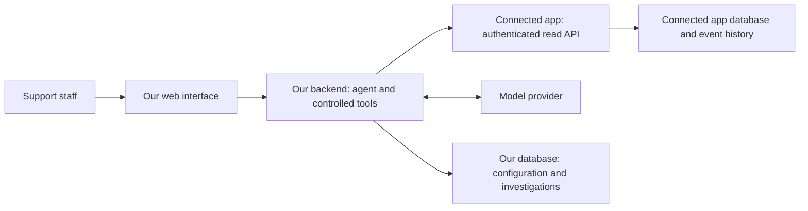

# Support investigation agent — first-project plan

November 5, 2026. The user accepted this direction for detailed planning and asked about platform, database connectivity, distribution, and the application layer. Planning is selected; implementation, target-app access, deployment, demand, and competitive uniqueness are not established.

**Current release authority:** the [final build plan](support-investigation-final-plan.md) covers all four proposed differentiators, LibreBooking/MCP, storage/distribution, v0.1–v1.0 gates and conditional expansion. The earlier roadmap and five-stage sketch below are historical design context; their release sequencing is superseded. Every version remains unbuilt. Documentation and limited source feasibility checks are saved in the [evidence register](../ideas/support-investigation-feasibility-2026-11-05.md).

## Recommendation and reason

Start with a support agent that investigates booking problems in one web application and prepares an evidence-backed explanation for the person handling support.

This connects familiar full-stack work—business APIs, records, authorization, event history, and a useful UI—to genuine agent behavior: interpreting a complaint, choosing relevant lookups, and deciding what information is still missing. The workflow can be evaluated without automating a browser or introducing payment writes. Relative to the other liked ideas, onboarding has strong direct importer overlap, while reproduction adds browser/test-environment complexity. Neither is rejected; both remain later candidates. Do not start all three as one platform.

The proposed domain is a booking application because it is relevant to the kinds of products described in this workspace. It is not a finding that Pepper or the automotive app currently has these problems, exposes the required APIs, or records adequate history. No other repository has been inspected or changed for this plan.

## User, task, and first useful outcome

Initial user hypothesis: a developer or support operator responsible for a small booking-based web application.

Illustrative input: “The customer says they moved their appointment, but it still shows the old time.”

Expected journey:

1. Operator selects the authorized customer/booking and enters the complaint.
2. Agent retrieves the relevant current record, operation history, and applicable policy results through narrow tools.
3. It produces an evidence timeline and distinguishes established facts, a possible explanation, and missing information.
4. Operator reviews a draft response or an engineering handoff with identifiers and evidence needed to continue.

Illustrative outcome: history establishes that a reschedule was rejected because the target slot was unavailable. The explanation cites the rejected operation and the relevant rule result. A different case with missing history must remain inconclusive; the agent cannot infer that an attempt never happened simply because no event was found.

The first useful release completes this investigation and handoff. Success means a reviewer can understand and verify what happened with less manual reconstruction; it does not require the agent to change the booking.

Build the first end-to-end slice around **rescheduling only**. Once that journey works with both supported and inconclusive outcomes, extend it to cancellation and refused bookings within the same bounded release. Do not build all complaint types, integrations, and screens in parallel before proving the first journey.

## Bounded first release

| Area | Proposed scope |
| --- | --- |
| Integration | One booking application's documented read API or adapter, initially exercised with synthetic records |
| Complaint types | Reschedule did not take effect; cancellation appears not to have taken effect; a booking attempt was refused |
| Interaction | One operator-facing web screen, one investigation at a time |
| Agent | One agent with four narrow read tools: account context, booking context, operation history, policy/decision lookup |
| Result | Evidence references, timeline, supported findings, explicitly uncertain hypotheses, missing evidence/questions, editable response/handoff draft |
| Execution | Bounded tool calls and clear stopped/failed/partial outcomes; a retry does not silently reuse outdated evidence |
| Initial data | Fictional tenants, customers, bookings, decisions, and events; no real customer data required for planning fixtures |

Tool schemas, identity rules, historical policy availability, and the intended app are design dependencies to settle before implementation. A declared synthetic adapter can test the contract but does not validate compatibility with an existing app or prove customer usefulness.

Keep automated refunds, booking changes, outgoing messages, autonomous code fixes, general database access, many connectors, and multiple specialized agents outside this first release. They are additional products/workflows to justify later. The core release still needs sound authorization, privacy, failure handling, and accessible review interactions.

## Architecture outline

Use a small web UI and a backend that owns the investigation state, tool execution, and access checks. Keep the agent and deterministic tools in one service initially; split deployment only for a demonstrated operational reason. Store investigation metadata and evidence references in an ordinary database when persistence is needed. No distributed agent framework, vector database, or separate microservice fleet is justified by the current scope.

The model proposes what to look up and how to explain it. Code controls what it may retrieve, evaluates business rules where required, checks returned evidence references, and distinguishes source errors from empty results. Tool access is tied to the authenticated operator and selected tenant/customer rather than trusting identifiers supplied by the model. Customer messages and retrieved text are untrusted data.

For each finding, retain the source identifier, version or observation time, and scope. Distinguish historical decision evidence from a present-day rule evaluation: today's policy cannot establish why an old request failed. If sources conflict or change during an investigation, disclose the conflict/staleness and require a fresh check rather than asserting a single certain story.

Choose implementation language, database, and model after confirming the app/API and practical deployment constraints. These choices must serve the workflow; the plan does not assume a skill gap or force the user's current stack.

## Platform, connection, and distribution plan

### Recommended product shape

A browser-based support workbench with a server-side investigation backend. The initial adopter is a developer/team that owns a booking application's backend; its support staff use the workbench. A developer connects the app once, then authorized operators investigate selected cases through the web UI. A shop that only uses an unrelated vendor's booking website would need that vendor's supported API/integration; entering a public website URL does not expose private booking history.

This is a proposed deployment model, not a deployed service. Keep the first setup to one web application/backend and its small persistence database. Hosting vendor, framework, billing, custom model hosting, helpdesk plugins, and an embeddable widget are not required decisions for the current explanation or first journey.

The diagram represents logical components, not six independently deployed services. The connected app already owns its database; we build the workbench/backend, connection logic, and investigation storage. The model helps select tools and interpret the permitted evidence returned by them. API credentials and permissions are handled by backend code; the model receives the selected record fields needed for the case. This means model-provider data handling is a real integration consideration; this design does not promise that source data never leaves the connected company.

### Which layer it occupies

The tool sits at the **application/support operations layer**, alongside the booking application's existing backend. It starts when an operator opens an investigation. The ordinary customer booking journey continues through the booking app. The first release does not need to sit in every booking request, intercept browser traffic, or replace the booking backend.

The connected backend exposes evidence with business meaning: which booking, which attempted operation, whether it was accepted, and which recorded decision applied. A database row showing the current time alone does not explain why a previous reschedule failed. If the application has not recorded that decision/history, the connector must return an explicit evidence gap. Prospective event instrumentation might later improve evidence, but cannot recover a history that never existed.

### How data connectivity works

**Recommend a read-only application API connector first.** A small adapter translates the selected app's existing API responses into our agreed evidence format. If an app lacks those endpoints, its developer must expose equivalent scoped reads before a live integration can work. Adapter work is per supported app; an arbitrary database is not automatically understood.

Four proposed capabilities:

| Capability | Meaningful evidence returned |
| --- | --- |
| Account context | Authorized account/customer identifiers and the limited context needed for this investigation |
| Booking context | Selected booking state, relevant relationships, and source version/observation time |
| Operation history | Reschedule/cancellation/booking attempts, timestamps, outcomes, correlation identifiers, and completeness information |
| Policy/decision lookup | Recorded decision reasons and historical rule versions where available; current rule evaluation clearly labeled separately |

These are logical tool boundaries, not mandatory route names or final API schemas. A policy evaluation must use deterministic application logic rather than asking the model to decide eligibility from prose alone. The four capabilities could be served through a small number of existing routes; avoid adding endpoints that expose more than the task requires.

| Storage | Ownership and role |
| --- | --- |
| Connected app database/event store | Holds authoritative customers, bookings, and recorded operations. That app's backend authenticates requests and queries its own storage |
| Our investigation database | Holds users/workspace membership, connection metadata, case status, source references, approved drafts, and a deliberately limited evidence snapshot where needed. It is not a wholesale customer-database mirror |

Connection credentials stay server-side in protected secret storage, separate from browser-visible configuration and case text. The backend fixes the allowed integration destination and tools; the agent cannot supply an arbitrary connection URL. Every read is checked against the operator, connected workspace, and requested record. A connector credential with broad access cannot substitute for record-level authorization. Retention/deletion of saved evidence and model-provider use must be explicit before connecting live customer data.

A direct database connector is a possible later deployment choice. It would still need schema mapping, a restricted read service, record scoping, and access to historical decisions; SQL access does not supply missing business history. It adds integration and authorization work without solving the current first-journey problem, so it is not the proposed initial connection mode. A customer's database engine can vary behind its API without changing the agent's evidence contract.

### How people would use a published version

1. **Public portfolio demo:** visitor opens the site, selects a fictional reschedule complaint, runs an investigation against the demo adapter, and inspects the evidence and result. Include clear fictional-data labeling, per-run limits, and isolated/resettable case state. No visitor needs production credentials. A demo proves the declared journey, not compatibility with arbitrary apps or customer adoption.
2. **First connected installation:** a developer deploys/configures the supported API adapter, supplies the allowed API destination and scoped credentials through backend setup, and verifies the connection with known safe examples. Operator access is set up for that workspace. This is developer-assisted onboarding; it is not zero-configuration consumer signup.
3. **Routine staff use:** authorized staff sign in, select the connected workspace and relevant customer/booking, enter a complaint, review the investigation, and edit/copy the draft. The first release does not send customer messages or change bookings.

Start by demonstrating the hosted fictional workflow, then support one real app integration when its owner authorizes access and the required evidence exists. A source repository plus deployment guide could later support self-hosting, and a helpdesk widget could reuse the backend after the independent staff workflow is useful. These are planned distribution options; no public repository, app, deployment, account, or release has been created or authorized by the planning discussion alone.

The connection pattern is established in existing products: [Fin Procedures](https://www.intercom.com/help/en/articles/12495167-fin-procedures-explained) describes internal-system connectors and deterministic controls, and [Fin's Stripe integration](https://fin.ai/integrations/connectors/stripe) uses live business data. Rechecked November 5, 2026. A Cal.com link surfaced in that integration directory, but its detail fetch failed; no detailed capability conclusion is drawn from it. Publishing a connector/workbench does not itself establish a product difference. The exact booking-decision investigation still needs the comparison gate below.

## Milestones and completion criteria

The table below is the original high-level sketch. Use the [final build plan](support-investigation-final-plan.md) for current deliverables and exit criteria.

| Milestone | Concrete output | Complete when |
| --- | --- | --- |
| 1. Investigation contract | Three complaint definitions, evidence/tool schemas, and twelve synthetic case specifications with expected findings | A reviewer can distinguish answerable, ambiguous, unauthorized, unavailable, and stale cases before any model output exists |
| 2. Baseline and gap decision | Manual/scripted investigation of the same cases; exact comparison with a configured support agent where actual access exists | Record which useful operation is missing, setup effort, operator effort, and evidence limits. Documentation alone cannot establish a competitor gap |
| 3. Working agent core, after direction/implementation authorization | One agent completing the read-tool loop with structured evidence-linked results | Cases resolve or stop for the declared reason; unsupported evidence references and cross-account access fail at code boundaries |
| 4. Complete operator journey | Complaint input, visible investigation status, evidence review, editable draft, retry/cancel behavior | Another person can run the declared task from setup through a verifiable result without hidden manual repair |
| 5. Evaluation and portfolio evidence | Reproducible case run, failure walkthrough, measured costs/latency, setup guide, and honest case study | Claims match observed runs; limitations and baseline comparison remain visible |

These are ordered milestones, not elapsed-time estimates or completed work. The actual app integration, available development time, and evidence access affect scheduling. No product code, fixture corpus, test runner, or separate repository has been created.

### Twelve proposed evaluation cases

Declare expected facts and acceptable unresolved outcomes independently of the agent:

1. Reschedule rejected with a recorded unavailable-slot decision.
2. Successful reschedule with evidence that the complaint concerns an older observed state.
3. Customer refers to a different booking from the operator's initial selection.
4. Cancellation rejected with an explicit recorded policy decision.
5. Cancellation accepted but the current record conflicts with the operation history.
6. Cancellation complaint with missing operation history.
7. Booking attempt refused for a recorded staff/resource constraint.
8. Booking attempt occurred under a different policy version from today's rules.
9. Account/booking identifier points to another tenant or unauthorized customer.
10. Tool times out or returns an error rather than an empty event list.
11. Retrieved text attempts to redirect the agent or expose unrelated account data.
12. Source state changes between evidence retrieval and final review.

These case descriptions are planned, not test results. For ambiguous customer identification, the correct next action is a clarification, not selecting a similar name automatically.

Proposed release requirements: no unauthorized records returned; every asserted factual finding supported by retrieved evidence; no unsupported root-cause claim on missing/conflicting history; no successful completion when required retrieval failed; correct historical-versus-current policy distinction; safe retry/cancellation; unchanged source records. Measure reviewer correction burden, task completion, latency, model cost, and tool calls in a declared environment. Do not announce time savings or reliability percentages before actual measurements. Synthetic cases test engineering behavior; practical usefulness needs an appropriately authorized real-task review later.

## Evidence, alternatives, and the originality gate

The [practical-agent shortlist](../ideas/discovery-07-practical-agents.md) records the checked sources and limits. An anonymous [SaaS discussion](https://www.reddit.com/r/SaaS/comments/1w8yy12/whats_your_process_when_a_customer_says_this_is/) describes the back-and-forth involved in incomplete reports. This supports a problem hypothesis, not demand for this exact agent. The investigation example and case list above are fictional design inputs.

[Fin Procedures](https://www.intercom.com/help/en/articles/12495167-fin-procedures-explained) and [live Stripe integration](https://fin.ai/integrations/connectors/stripe) already demonstrate that support agents can use connected business data and act through workflows. Showing evidence or using narrow tools is not, by itself, a new product capability. The proposed advantage to test is faster, accurate reconstruction of a specific booking decision and a useful evidence handoff when history is incomplete or inconsistent. It has not been established that existing support tooling cannot do this with equivalent API access.

**Start with the bounded contract and comparison.** If a configured existing tool or a small scripted flow adequately completes the same task, do not call a reproduction of it a meaningfully differentiated standalone product. Choose an app-specific integration/contribution if the user wants that portfolio route, or revise the precise problem. This is an early decision gate, not a request to spend months researching before doing concrete work. Neither scope reduction nor enthusiasm for agents removes the originality requirement.

## Current status and next action

User-confirmed: accepted support investigation for detailed planning after liking all three directions; can work on multiple things but wants a main focus. Target-app choice, source access, implementation, and public release remain unsettled. The hosted workbench plus read-only API connector is the advisor's proposed architecture, not a user-confirmed deployment choice or implemented system.

The [final build plan](support-investigation-final-plan.md) contains the current four-feature scope, twelve-case ledger, revised releases and starting work order. Next: verify pinned LibreBooking runtime/capture feasibility and prepare a fair paired baseline when implementation is authorized. Public source research is complete only to the limits in the evidence register; no executable fixtures, model benchmark, runtime comparison or product implementation exists yet. Keep Everyday Pepper ongoing; no feature in its brief is treated as implemented. Retain data onboarding and bug reproduction as secondary possibilities and lab reconciliation as the previously liked backup.
