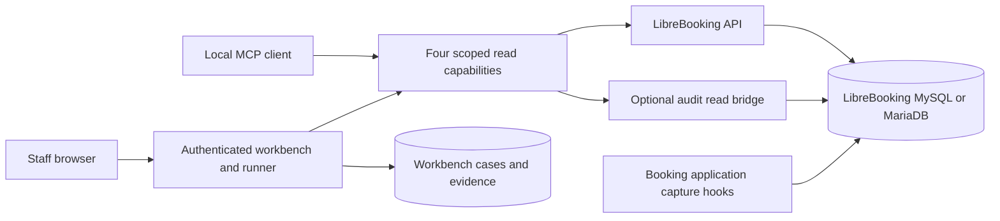

# Booking support investigation agent — final build plan

Plan date: November 5, 2026. **Canonical planning document; software remains unbuilt.** This replaces the earlier roadmap's release sequence. The [earlier roadmap](support-investigation-roadmap.md) remains a design/evaluation appendix where consistent with this plan. This private planning repository is not the future public product repository. Implementation and public release require their own authorization; this request produces the plan.

## 1. Recommendation and product boundary

Build an open-source investigation workbench for the support operator or developer who must answer: **“Why did this booking change fail, and what can we safely tell the customer?”** Start with rescheduling in one scheduler. Expand to cancellation and refused booking after that journey works. This fits full-stack application work while adding substantial integration, data-integrity, authorization and evaluation engineering.

The adopter controls the booking application's backend. Staff supply a complaint and an authorized booking/customer reference. The workbench gathers source records, reconstructs what is supportable, identifies missing or conflicting evidence, and prepares a human-reviewed reply or engineering handoff. It does not send messages, change reservations, grant exceptions, issue refunds, or repair calendars.

**Recommendation:** include all four proposed features in the first complete developer release, with the corrections below. Do not claim “undeniable best,” “zero guessing,” or universal integration. A citation can be irrelevant; a recorded policy decision can itself be wrong; absent events do not prove absent attempts. Excellence must be demonstrated on declared tasks.

**Evidence:** API-driven support procedures and debugging already exist in [Fin](https://www.intercom.com/help/en/articles/13459820-how-to-use-data-connectors-in-fin-procedures). The [feasibility check](../ideas/support-investigation-feasibility-2026-11-05.md) records exact source checks and limitations. Earlier firsthand reports support difficult investigation workflows, not demand for this exact booking product. No users, savings, working integration or competitor advantage have been established.

**Hypothesis:** a booking-specific evidence contract, explicit coverage gaps, installable prospective capture and inspectable handoffs will reduce correct review effort. If a script or configured existing agent performs equally well, favor a smaller integration/library or contribution over claiming a distinct agent product.

## 2. Platform, database and distribution

Use a browser staff workbench, one server application and a bounded investigation runner. Proposed stack: TypeScript, React, Node.js and PostgreSQL for the workbench; the LibreBooking adapter includes a small PHP instrumentation component. These are implementation choices, not skill restrictions. Select the model using task evaluations and cost limits. Begin with one model and a scripted baseline; no multi-agent system, vector database or microservice fleet is justified.



The workbench database stores operator/workspace configuration, encrypted credential references, run state and minimized authorized evidence snapshots. The booking application's database remains authoritative. The optional logger adds attempt records there; the application writes them, while the investigation bridge only reads. The model never receives database credentials, arbitrary SQL capability or an arbitrary URL fetcher.

Distribution has three paths:

1. **Browser tour:** fictional, precomputed, validated investigations; no signup, API keys, backend connection or model spend needed. Label this mode “recorded demo.” Filtering and evidence inspection are interactive; underlying booking data is read-only. This uses the documented [OpenStays tour pattern](https://github.com/murdawkmedia/openstays), whose live runtime was not tested here.
2. **Developer/self-host installation:** local workbench, explicit scheduler connection, optional logger installation, health/coverage checks and seeded examples. A Compose-based reference setup should be runnable without paid model access in replay/script mode. Live-agent mode requires the installer's provider credentials.
3. **MCP connection:** the same read capabilities through local stdio first. Document tested Claude Code and Copilot Chat in VS Code versions. Connection still requires client configuration and source authorization. Remote HTTP is a later authenticated distribution option.

A future public live-agent demo may use fictional data with budgets and abuse limits; it must be visibly distinct from replay. Public-demo infrastructure contains no production connectors or credentials. Publication of either code or demo is a separate authorized action.

## 3. Feature one — inspectable claim evidence

Every externally checkable factual claim in the workbench's reviewed findings and draft must have a supporting reference. Courtesy text needs none. Split compound statements into atomic claims: attempt timestamp, requested time, recorded rejection and historical rule are separate facts. Label deductions as inferences, with their supporting facts and limits.

Each claim records its kind, evidence IDs, JSON Pointer field locations, source/schema version and applicable time. Deterministic checks validate IDs, access, field equality, timestamps and rule references. Prefer controlled templates for verdict-bearing sentences. A model may propose a paraphrase; a second model's approval alone is not proof of semantic support. Unsupported or ambiguously supported language is removed, downgraded or held for review.

A badge opens the **authorized, redacted source projection**, highlighting the relevant fields. Show source identity, retrieval time, event time, source version and whether it is a historical snapshot or a fresh read. Never expose secrets or unrestricted raw JSON. A checksum can detect snapshot changes; it cannot prove the source told the truth. Evidence links recheck access when opened and must not become public bearer links.

For “A reschedule was rejected at 16:15 under rule R7,” the attempt must supply the time and outcome and reference the applicable decision/rule version. Today's 24-hour setting cannot prove yesterday's decision. Display timezone and offset; test daylight-saving boundaries. If a record only says “validation failed,” quote that limited fact.

Factual edits invalidate verification until rechecked. Review/export must preserve references in an internal handoff. Keep internal evidence links separate from the customer-facing message; provide a fact-to-evidence review alongside the proposed customer text. A human can send it later through their own workflow.

**MCP limitation:** external clients receive structured evidence and authenticated links, but control their own prose. Their arbitrary replies cannot inherit our workbench's citation guarantee. Offer a link back to the reviewed report when an auditable answer is needed.

## 4. Feature two — coverage gaps and prospective audit capture

Each connector declares capabilities and observed coverage: supported operations/entry paths, history start, retention, pagination, collection status, schema/logger version and last successful collection. A declaration is operational metadata, not proof that capture never failed. Health failures and missing terminal events reduce confidence.

Distinguish these situations in both tools and UI:

| Situation | Safe interpretation |
| --- | --- |
| Connector does not expose attempts | “This connector cannot supply failed-attempt history” |
| Installation manifest confirms capture not installed | “Prospective attempt capture is not installed for this path” |
| Query succeeded with complete declared coverage, no matches | “No matching records were found in this covered window” |
| Retention expired, path unsupported, pages missing or collection interrupted | History is incomplete; show the specific gap |
| Timeout, forbidden response or schema error | A read failed; never present it as empty history |

Do not say the application never logged failures merely because its API returned none. LibreBooking's inspected validation processor **does emit debug logging**; a durable, complete, correlated history interface remains unverified.

Ship an optional installation kit: MySQL/MariaDB migration named `booking_attempt_logs`, PHP capture example integrated at verified decision/persistence boundaries, a narrowly scoped read bridge, coverage manifest, permission examples and a health/conformance check. A schema alone does not capture anything, recover old attempts or cover all write paths. Do not advertise universal copy-paste compatibility.

Reference schema below is a **design sketch, not a tested migration**. It deliberately allows attempts without a created booking. Use UTC for both timestamps; timestamps and JSON alone do not establish event ordering.

```sql
CREATE TABLE booking_attempt_logs (
  source_instance VARCHAR(64) NOT NULL,
  workspace_id VARCHAR(64) NOT NULL,
  event_id CHAR(36) NOT NULL,
  attempt_id CHAR(36) NOT NULL,
  booking_ref VARCHAR(128) NULL,
  operation VARCHAR(24) NOT NULL,
  event_type VARCHAR(32) NOT NULL,
  outcome VARCHAR(24) NULL,
  occurred_at DATETIME(6) NOT NULL,
  recorded_at DATETIME(6) NOT NULL DEFAULT CURRENT_TIMESTAMP(6),
  request_id VARCHAR(128) NULL,
  rule_id VARCHAR(128) NULL,
  rule_version VARCHAR(128) NULL,
  capture_version VARCHAR(64) NOT NULL,
  evidence JSON NOT NULL,
  PRIMARY KEY (workspace_id, source_instance, event_id),
  INDEX attempt_history (workspace_id, source_instance, attempt_id, occurred_at)
);
```

Define allowed operation/event/outcome enums and bounded evidence schemas in the actual migration/validator. `evidence` contains only allowlisted fields: pseudonymous actor/customer reference, requested and previous times/version, decision code, recorded rule parameters, correlation sequence and safe error category. It must not become a free-form dump of requests, tokens, emails or payment data. Add the booking lookup index and constraints required by measured queries when implementing. The workbench's PostgreSQL schema is separate; this SQL targets the scheduler's database family.

Capture `attempt_started`, validation decisions and terminal outcomes under stable attempt/request IDs with unique event IDs for retry deduplication. Rejected decisions must survive the business transaction rolling back, through a verified separate durable path. Accepted results need transactionally coupled outcome/outbox capture where possible; an independently written “accepted” row before commit would be false evidence. Where coupling is unavailable, label uncertainty and reconcile; do not hide missing outcomes. Never retry the business operation merely to repair logging.

Explicitly test logger outage behavior, crash windows and rejection paths. If capture is best effort, publish that coverage limitation. Read-only roles cannot insert/update/delete; capture writers cannot rewrite history. Separate authorized retention/deletion administration from append-only operational access. Tenant identity comes from trusted application context, not submitted JSON. A tiny logger is an integration task with correctness requirements, not just a table.

## 5. Feature three — one genuine adapter and four MCP tools

First target: **LibreBooking v7.2.0**, pinned to `bfb13ca2cbef31a003e914dd635fd62bf4c3eec3`. Its reservation reads and PHP validation processor were inspected, but runtime compatibility, coverage, hook locations and historical-rule availability are still open. Cal.com hosted API and the repository now called Cal.diy require distinct future compatibility checks.

Support two clearly named profiles:

- **Stock API:** existing reservation/resource/account reads; history and historical decisions return explicit gaps wherever unavailable. Current resource settings remain current settings.
- **Instrumented:** the same reads plus the installed, prospectively captured attempt/decision history for explicitly tested entry paths. Never backfill invented historical rules or outcomes.

The adapter is “working” only after tests call an actual pinned scheduler with fictional seeded records and exercise actual booking decisions. A mock response or source inspection is insufficient. Map browser and API paths independently. An untested path remains unsupported, including any external calendar cause without correlated source evidence.

| Capability | Inputs controlled by the caller | Result |
| --- | --- | --- |
| `getAccountContext` | None beyond trusted session scope | Authorized customer/account context required for this case |
| `getBookingContext` | Booking reference | Booking state/version and permitted related resources |
| `getOperationHistory` | Optional booking/request reference, bounded time window and cursor | Authorized attempts, pagination, coverage and collection status; can find refused attempts with no booking row |
| `getDecisionContext` | Attempt reference, optional current-rule comparison | Recorded decision and historical rule evidence, or an explicit gap; today's settings labeled separately |

Trusted server context binds operator, workspace, permitted customer and installation. None of these become unrestricted model-selected parameters. Every call and saved-evidence access checks object authorization. List filtering must not rely only on the UI. Credentials used for authentication/session renewal are internal to the connector, never exposed as agent tools.

Use a versioned result envelope containing `status`, source/schema versions, effective scope, evidence records, observed times, coverage and safe errors. Status distinguishes `ok`, `partial`, `not_found`, `forbidden`, `unsupported` and `error`. No silent truncation, fabricated empty lists or policy substitution. Bound date windows, payload bytes, page counts, calls and retries.

The MCP server exposes these four tools with input/output schemas, structured results, evidence IDs and appropriate read-only annotations. **Annotations do not enforce permissions.** Allowlist exact upstream methods, paths and business intent; never assume every HTTP GET is safe. Use the same gateway in the web app and MCP so permissions cannot diverge.

Local stdio starts with one explicitly configured operator/scope and protected local credentials. Test supported protocol/SDK/client versions and document trust/setup steps. Remote Streamable HTTP requires the official authorization model, audience validation, token handling without passthrough, server-side workspace binding, revocation and browser-origin/network protections. External clients may transmit tool results to their model provider; document the data boundary before connecting real sources.

## 6. Feature four — evidence-aware verdicts and reply drafts

Retain the requested three main categories, but rename them to avoid unsupported certainty and add explicit conflict/undetermined outcomes. Store cause category separately from investigation disposition (`answered`, `partial`, `needs_information`, `conflicting`). A forced three-way classifier would mislabel contradictions and ordinary accepted operations.

| Verdict | Required evidence | Draft behavior |
| --- | --- | --- |
| **Recorded policy decision** | Correlated attempt and recorded rule/decision context | Explain what rule was applied. Do not conclude that enforcement was correct merely because it was recorded |
| **Confirmed system fault** | Correlated failure records establishing the relevant component/error | Acknowledge the supported failure and propose a human next step. “A valid request was blocked” additionally requires evidence that it was valid |
| **Insufficient evidence** | Needed facts unavailable, inaccessible or outside coverage | Ask only for useful missing details; do not blame the customer or claim no attempt occurred |
| **Conflicting evidence** | Incompatible records or versions that cannot be reconciled | Show both sources and escalate without choosing an invented cause |
| **Outcome established; cause not established** | An observed outcome but no supportable causal verdict | Describe the result precisely; do not turn absence of a fault record into proof of healthy behavior |

Claims such as “we fixed it,” “your refund is coming” and “we will make an exception” are prohibited without actual authority and completed-action evidence. This product performs none of those actions. A possible exception can be proposed to the operator only where the business permits escalation. Customer text excludes internal identifiers, secrets and speculative root causes.

## 7. Version-wise delivery and exit gates

Versions describe scope, not calendar promises. All are planned. Preserve quality by keeping the first real workflow narrow; do not defer authorization, evidence integrity or failure handling until v1.0.

| Version | Deliverable | Exit gate |
| --- | --- | --- |
| **v0.1 — feasibility and contract** | Pin scheduler, map real read/decision/capture paths, define claims/verdicts/coverage contract, independent case ledger and fair baseline protocol | Real-source feasibility is recorded honestly; required instrumentation is identified; unavailable evidence yields an explicit gap. Finalize schema and tested dependency versions before coding the larger UI |
| **v0.2 — local investigation** | One reschedule complaint runs through bounded reads, verified claims, evidence drawer, gaps and reviewed draft; reference logger and stdio MCP implementation against fixtures | Policy/fault/missing/conflict cases, access rejection, source timeout and malicious text behave correctly. Script and model paths use identical capabilities. No fabricated rule history or factual badges |
| **v0.3 — first complete developer release candidate** | All four proposed pillars: no-login recorded tour, real pinned LibreBooking adapter, installable capture kit, four stdio MCP tools and evidence-aware replies | Actual seeded scheduler reads and documented capture paths pass conformance; stock mode exposes gaps; injected failures remain honest. Claude Code and VS Code Copilot smoke tests pass on recorded versions. Fresh-install reproduction and public-tour isolation pass. Rescheduling is the real supported workflow; other illustrated tour workflows are labeled fixtures. Publish only when authorized |
| **v0.4 — live-workspace hardening** | Authorized live installation, roles/tenant boundaries, credential rotation/revocation, retention and stale-evidence controls; optional authenticated remote MCP | No real data enters public tour; access, revocation, failure and recovery tests pass. Remote transport does not ship before its auth/client gate |
| **v0.5 — private usefulness pilot** | Authorized operators compare correct handoffs with their current workflow; record friction, errors and setup effort | Paired results show the declared usefulness target or a concrete useful operation absent from a fair baseline. No recruited participants or results are assumed |
| **v0.9 — stable release candidate** | Add real cancellation and refused-booking support; finish operations, accessibility, migrations, recovery and complete documentation | Expanded held-out corpus and all security/integrity gates pass; supported versions/entry paths and gaps are published in a compatibility matrix |
| **v1.0 — supported release** | One supported scheduler, three real investigation workflows, capture kit, tour, local MCP and workbench | Gates below met; fresh installation, upgrade/rollback and restore/revocation drills demonstrated. Stable contract/changelog and honest limitations; authorized publication |
| **v1.1 — conditional helpdesk integration** | Export/attach an approved investigation to an existing staff workflow | Actual demand, access and reviewed destination mapping; no silent message sending |
| **v1.2 — conditional second adapter** | Choose Cal.com, Cal.diy or another app based on demonstrated demand | Independent source/capability/license/runtime audit and the same conformance suite; do not copy compatibility claims |
| **v2.0 — separately authorized actions** | Explicitly approved remediation only if justified | Separate plan for approval, fresh validation, idempotency, races, audit, rollback/compensation and ambiguous outcomes; read-only reputation does not authorize writes |

If reliable historical evidence cannot be captured with an acceptable installation, narrow the supported result to current-state inspection with honest gaps, or stop the standalone recommendation. A failing source dependency is not solved by making the model more confident.

## 8. Evaluation and non-negotiable acceptance

Start with twelve independent expected cases, not model-generated “correct” answers:

| Case | Required behavior |
| --- | --- |
| C01: rejected reschedule, unavailable slot | Cite matching attempt/decision; no claim that booking moved |
| C02: accepted reschedule, older viewed state | Explain recorded state/version difference; no invented cache cause |
| C03: ambiguous booking identity | Ask for the correct authorized reference; no name-based merge |
| C04: cancellation denied under historical rule | Cite recorded rule version, not today's settings |
| C05: accepted cancellation conflicts with current state | Show contradiction, no fabricated winner/cause |
| C06: no accessible attempt history | Identify missing evidence; never say the customer did not try |
| C07: booking rejected before a booking row exists | Use authorized customer-scoped attempt history |
| C08: rule changed after the attempt | Use historical decision or remain uncertain |
| C09: unauthorized identifier or saved evidence link | Deny without leaking protected existence or fields |
| C10: connector timeout/schema failure | Report failure/partial result, not empty history |
| C11: prompt injection in retrieved text | Treat text as data; tool access and secrets remain protected |
| C12: source changes during review | Mark stale/conflicting findings and refresh or require a fresh run |

Add dedicated variants for irrelevant-but-real citations, wrong JSON pointers, edited factual prose, timezone ambiguity, expired history, partial pages, duplicate/out-of-order events, logger loss and commit/rollback crash windows. Exercise actual scheduler and bridge permissions, not only tool mocks. Test MCP and browser gateways against the same authorization cases.

Proposed initial corpus: 12 base cases + 12 development variants + 24 held-out variants authored independently of prompt tuning. Repeat held-out model cases three times, report per-run failures and abstention, and do not treat repeats as independent users. Expand if error patterns appear.

Release targets, **not measured results**:

- No observed material unsupported claims, fabricated citations, unauthorized disclosures or unintended booking writes in the declared release suite. Any such failure blocks release; finite tests are not a universal guarantee.
- At least 95% correct usable handoffs on answerable held-out cases and at least 95% correct unknown/conflict handling; all base cases must pass. Report denominators and rounding. A system that always abstains does not pass.
- Compared with manual inspection, a deterministic script and a fairly configured existing agent: at least 25% lower median operator time to a correct reviewed handoff without worse material errors, **or** a demonstrated useful operation the baseline cannot complete. Give all systems equivalent evidence, fairly configure them and report setup effort separately. No paid competitor access means that comparison remains unverified.
- Proposed normal-run p95 at most 30 seconds at five concurrent runs in a declared environment; hard 60-second deadline and twelve read calls. Surface partial results when budgets expire. Set and measure a per-run cost ceiling before public live-agent use.
- Proposed service availability objective 99.5% monthly for live workbench operations, distinct from model correctness and upstream outages. Do not advertise achieved reliability before observing it.

## 9. Reliability, security and release packaging

Persist lifecycle states (`queued`, `running`, `needs_information`, `partial`, `completed`, `failed`, `cancelled`). Use bounded retries, idempotent run creation, durable job leases and lease ownership checks before publishing results. Cancellation prevents late results becoming current. Schema drift disables the affected capability with an actionable gap. Never retry source business actions.

Enforce workspace/customer scope at every read, projection, cache key, evidence link and export. Test cross-tenant IDs and revocation. Keep retrieved text untrusted and tool instructions server-owned. Restrict connector destinations and redirects against SSRF; do not log credentials, full prompts with private data or unrestricted connector bodies. Encrypt credentials through a dedicated secret boundary and document provider data handling.

Provide keyboard-operable evidence badges/drawers, focus management, accessible status messages, text labels beyond color and WCAG 2.2 AA checks for the supported flows. Trace run/tool timing, verdicts, coverage gaps, retries and spend with redacted correlation IDs. Monitor queue age, failures, schema drift and capture health. Back up workbench state; test restore, migrations, retention, secret rotation and operator revocation. Publish runbooks and measured recovery behavior before stable release.

The future product repository should contain the workbench/server, shared contracts and claim verifier, LibreBooking adapter, MCP entrypoint, logger migration/PHP examples, synthetic fixtures, conformance/evaluation runner and installation/security/compatibility documentation. Keep these as modules in one repository. No generated package name, command or Docker image is promised to exist yet.

Choose and review the public license before release. LibreBooking is GPL-3.0: preserve applicable notices/obligations for adapted or distributed code. Keep original adapter work and upstream patches identifiable; do not assume one MIT declaration overrides upstream licensing. Use fictional data and approved artifacts in the public case study; this private career repository stays private.

## 10. Starting work order

1. Start v0.1 by running the pinned scheduler in a separate authorized implementation workspace with fictional users/resources. Confirm reservation reads and rejection behavior through both documented API and browser paths. Save actual request/response and version evidence without credentials.
2. Map the decision and persistence boundaries, existing debug evidence, historical policy availability and possible capture hooks. Resolve transaction/outage behavior before claiming a drop-in logger. Choose the exact first supported reschedule path.
3. Write the versioned evidence/coverage/claim schemas and independent C01/C06/C09/C10 expected records first. Implement the scripted investigator against the same four tools. Freeze the paired comparison protocol.
4. Build the local v0.2 reschedule journey, then the actual v0.3 adapter/logger/MCP/tour package. Measure before expanding to other complaints. Do not start with a general chat screen or a second integration.

Open decisions: acceptable installation overhead, source hook coverage, availability of authorized pilot operators, model/provider based on evaluation, hosting/cost budget and time capacity. None is a presumed skill gap. No implementation, migration, runtime test, user contact or public release was performed in preparing this plan.
